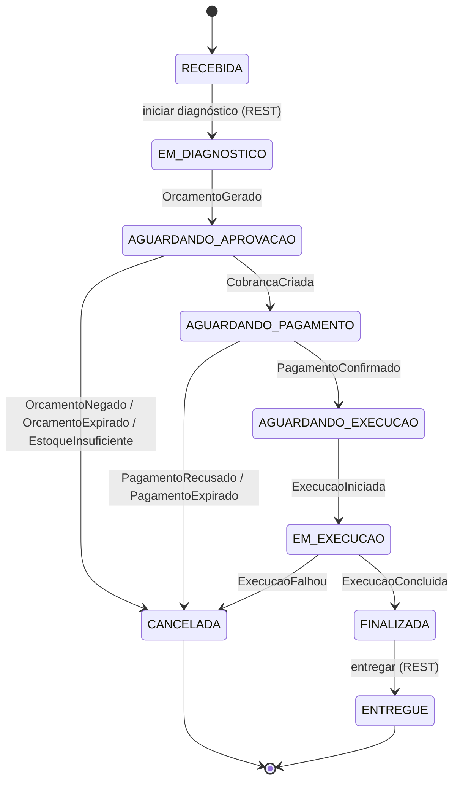
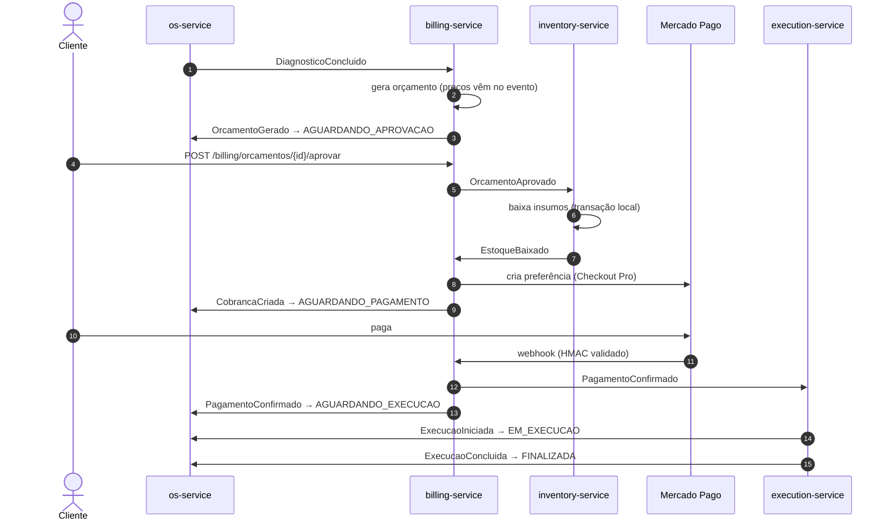
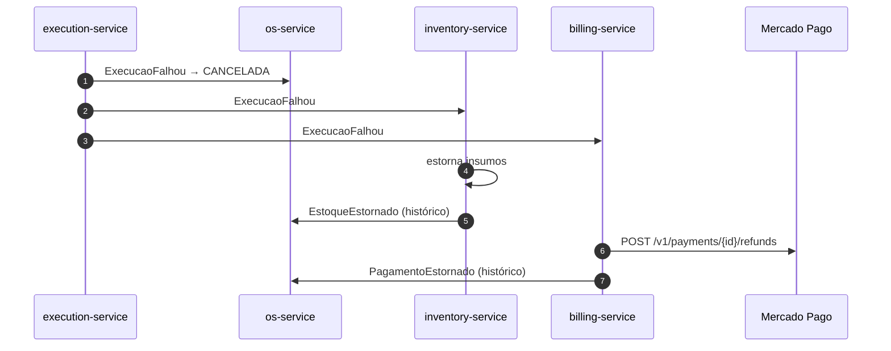

# 005 — Saga Coreografada para o Ciclo de Vida da Ordem de Serviço

**Status:** Proposta
**Data:** 2026-11-07

## Resumo
O fluxo transacional da Ordem de Serviço (diagnóstico → orçamento → aprovação → baixa de
estoque → pagamento → execução) atravessa quatro microsserviços com bancos isolados. Para
garantir consistência sem transação distribuída, adotamos o **Saga Pattern coreografado**:
cada serviço executa sua transação local, publica um evento de domínio e reage aos eventos
dos demais. Falhas disparam **eventos de compensação** que desfazem os passos anteriores
(estorno de estoque, estorno do pagamento, cancelamento da OS).

A mensageria é **Amazon SNS (fan-out) + Amazon SQS (uma fila por consumidor)**, com
**Transactional Outbox**, **consumidores idempotentes** e **DLQ** em todas as filas.

Esta ADR substitui parcialmente a [004](004-padrao-comunicacao-rest.md): REST continua sendo o
padrão para a borda (cliente → API Gateway → serviços) e para consultas síncronas pontuais;
a integração entre serviços passa a ser assíncrona.

## Problema
Na Fase 4 a aplicação foi dividida em microsserviços, cada um com banco próprio:

| Serviço | Responsabilidade na Saga | Banco |
|---|---|---|
| `oficina-app-api` (OS Service) | Dono do ciclo de vida e do histórico da OS | `oficina_db` |
| `oficina-billing-service` | Orçamento, aprovação, cobrança (Mercado Pago) e estorno | `billing_db` |
| `oficina-inventory-service` | Baixa e estorno de insumos | `inventory_db` |
| `oficina-execution-service` *(a criar)* | Fila de execução, diagnóstico/reparo, conclusão | próprio |

O requisito do Tech Challenge proíbe acesso direto ao banco de outro serviço e exige
rollback seguro caso qualquer etapa falhe. Uma única transação ACID não é mais possível,
e chamadas REST encadeadas criariam acoplamento temporal (se o billing estiver fora, a OS
trava) e não oferecem compensação.

## Proposta técnica

### 1. Estilo: coreografia
Não há orquestrador central. Cada serviço conhece apenas os eventos que consome e os que
publica. O `oficina-app-api` é a **fonte da verdade do estado da OS** e registra cada evento
recebido no histórico (`historico_ordem_servico`), o que atende "consulta de status e
histórico" e serve de *saga log* para auditoria e para o vídeo de demonstração.

### 2. Infraestrutura de mensageria

```
            ┌──────────────────────┐
 os-service │ SNS oficina-os-events│──┐
            └──────────────────────┘  │   assinaturas com
 billing    ┌───────────────────────────┐ │   filter policy
            │ SNS oficina-billing-events│─┤   por eventType
            └───────────────────────────┘ │
 inventory  ┌─────────────────────────────┐│     ┌─────────────────┐   ┌──────────────┐
            │ SNS oficina-inventory-events│├────►│ SQS <servico>-q │──►│ SQS <serv>-dlq│
            └─────────────────────────────┘│     └─────────────────┘   └──────────────┘
 execution  ┌─────────────────────────────┐│      (uma fila por serviço consumidor)
            │ SNS oficina-execution-events│┘
            └─────────────────────────────┘
```

- **Um tópico SNS por serviço produtor**, **uma fila SQS por serviço consumidor**. Cada fila
  assina os tópicos de que precisa com *filter policy* sobre o atributo `eventType`.
- Cada fila tem DLQ com `maxReceiveCount = 5` e alarme no CloudWatch quando a DLQ fica
  com mensagens.
- Provisionamento via Terraform em `oficina-infra-cluster/messaging.tf` (ver
  [Decisões tomadas na implementação](#decisões-tomadas-na-implementação)).
- Filas **Standard** (não FIFO): a ordem é garantida pelas regras de transição de estado
  (item 5), e não pela fila.

### 3. Envelope padrão dos eventos

Todos os eventos usam o mesmo envelope JSON. O `sagaId` é o próprio `ordemServicoId`.

```json
{
  "eventId": "8f1c2a3e-6d0b-4b8e-9a51-2f7e4c9d1a00",
  "eventType": "OrcamentoAprovado",
  "eventVersion": 1,
  "occurredAt": "2026-11-07T14:32:10.512Z",
  "producer": "oficina-billing-service",
  "sagaId": "3c9a7e1b-...-ordemServicoId",
  "payload": { }
}
```

Atributos de mensagem SNS/SQS: `eventType` (usado no filtro) e `traceparent` (W3C Trace
Context, para o rastreamento distribuído no New Relic).

### 4. Catálogo de eventos

#### Fluxo principal

| # | Evento | Produtor | Consumidores | Payload principal |
|---|---|---|---|---|
| 1 | `DiagnosticoConcluido` | os-service | billing | `ordemServicoId`, `clienteId`, `veiculoId`, `servicos[{servicoId, descricao, quantidade, precoUnitario}]`, `insumos[{insumoId, descricao, quantidade, precoUnitario}]` |
| 2 | `OrcamentoGerado` | billing | os | `ordemServicoId`, `orcamentoId`, `valorTotal` |
| 3 | `OrcamentoAprovado` | billing | inventory, os | `ordemServicoId`, `orcamentoId`, `insumos[{insumoId, quantidade}]` |
| 4 | `EstoqueBaixado` | inventory | billing, os | `ordemServicoId`, `itens[{insumoId, quantidade}]` |
| 5 | `CobrancaCriada` | billing | os | `ordemServicoId`, `cobrancaId`, `valor`, `checkoutUrl` (Checkout Pro) |
| 6 | `PagamentoConfirmado` | billing (webhook MP) | execution, os | `ordemServicoId`, `cobrancaId`, `mercadoPagoPaymentId`, `valor` |
| 7 | `ExecucaoIniciada` | execution | os | `ordemServicoId`, `iniciadaEm` |
| 8 | `ExecucaoConcluida` | execution | os | `ordemServicoId`, `concluidaEm` |

`EstoqueBaixado` é publicado mesmo quando a OS não usa insumos (lista vazia), para que a
cadeia continue sem caminho especial.

#### Eventos de falha e compensação

| Evento | Produtor | Consumidores | Gatilho |
|---|---|---|---|
| `OrcamentoNegado` | billing | os | Cliente recusa o orçamento |
| `OrcamentoExpirado` | billing | os | Sem resposta dentro do prazo (`orcamento.expiracao`) |
| `EstoqueInsuficiente` | inventory | os | Baixa falhou (saldo < quantidade) — nada foi baixado |
| `PagamentoRecusado` | billing (webhook MP) | inventory, os | Pagamento rejeitado pelo Mercado Pago |
| `PagamentoExpirado` | billing (scheduler) | inventory, os | Cobrança `PENDENTE` além do prazo (`cobranca.expiracao`) |
| `ExecucaoFalhou` | execution | billing, inventory, os | Reparo inviável durante a execução |
| `EstoqueEstornado` | inventory | os | Confirmação da compensação de estoque |
| `PagamentoEstornado` | billing | os | Confirmação do reembolso no Mercado Pago |

### 5. Máquina de estados da OS (os-service)

Estados novos em `OrdemServicoStatus`: `AGUARDANDO_PAGAMENTO`, `AGUARDANDO_EXECUCAO` e
`CANCELADA`.



Um evento que não corresponde a uma transição válida a partir do estado atual é
**registrado no histórico e descartado** (sem erro). Isso cobre entrega fora de ordem e
reentregas da fila Standard.

### 6. Fluxo principal



### 7. Compensações

| Falha em | O que já aconteceu | Compensação | Estado final da OS |
|---|---|---|---|
| Orçamento negado/expirado | Orçamento criado | Nenhuma (orçamento fica `NEGADO`) | `CANCELADA` |
| Baixa de estoque (`EstoqueInsuficiente`) | Orçamento aprovado | Nenhuma no estoque (baixa é atômica, tudo ou nada) | `CANCELADA` |
| Pagamento recusado/expirado | Estoque baixado | inventory estorna os insumos → `EstoqueEstornado` | `CANCELADA` |
| Execução (`ExecucaoFalhou`) | Estoque baixado + pagamento confirmado | inventory estorna insumos; billing reembolsa no MP (`CobrancaStatus.ESTORNADO`) → `PagamentoEstornado` | `CANCELADA` |

Exemplo de falha durante a execução:



Compensações são **idempotentes** e **sempre avançam** (nunca há "compensação da
compensação"). Se o reembolso no Mercado Pago falhar após as tentativas, a mensagem vai
para a DLQ do billing e o alarme sinaliza intervenção manual.

### 8. Garantias de entrega

- **Transactional Outbox** em cada serviço: a mudança de estado e o registro do evento na
  tabela `outbox` são gravados na mesma transação local. Um publicador agendado
  (`@Scheduled`) lê a `outbox` e publica no SNS, marcando como enviado. Evita o caso
  "salvou no banco mas não publicou" (ou o inverso).
- **Consumidor idempotente**: tabela `eventos_processados (event_id PK)` gravada na mesma
  transação do processamento. Evento repetido é ignorado.
- **At-least-once** ponta a ponta: o SQS pode entregar duplicado; outbox + idempotência
  tornam isso seguro.
- **Timeouts** (`OrcamentoExpirado`, `PagamentoExpirado`) gerados por scheduler no billing.
  Para a demonstração, os prazos são configuráveis via variável de ambiente.

### 9. Observabilidade
- O agente OpenTelemetry (já usado na Fase 3) instrumenta o AWS SDK. O `traceparent` é
  propagado nos atributos da mensagem, então um único trace no New Relic mostra a Saga
  inteira atravessando os serviços.
- Logs estruturados com `sagaId` e `eventType` em todo consumo/publicação.
- Dashboard no New Relic: OS por estado, compensações por tipo, profundidade das filas e
  das DLQs.

## Impacto esperado
- **Ganhos:** serviços desacoplados no tempo (billing fora do ar não perde eventos, eles
  ficam na fila); rollback explícito e testável; novo consumidor (ex.: notificações) entra
  só assinando um tópico; o histórico da OS vira trilha de auditoria.
- **Riscos:** consistência eventual (a OS pode ficar alguns segundos em estado
  intermediário); o fluxo fica distribuído no código, mitigado por este catálogo e pelo
  trace distribuído; mais infraestrutura para provisionar no Learner Lab a cada sessão.
- **Restrições:** depende de SNS/SQS liberados para a `LabRole` do AWS Academy (validar
  antes de implementar).

## Alternativas consideradas
- **Saga orquestrada (orquestrador próprio ou AWS Step Functions):** centraliza o fluxo e
  facilita a leitura, mas cria mais um serviço para manter e um ponto único de falha.
  Step Functions tem restrições no Learner Lab. Com quatro serviços e um fluxo linear, a
  coreografia cobre o caso com menos peças.
- **REST síncrono encadeado:** acoplamento temporal, sem compensação natural e com risco
  de cascata de falhas. Mantido apenas para consultas fora da Saga.
- **Kafka (MSK) / RabbitMQ:** o MSK é caro e pesado para o Learner Lab; RabbitMQ no próprio
  EKS exigiria operar persistência e alta disponibilidade. SNS/SQS são gerenciados e já
  integram com a conta. RabbitMQ no cluster fica como plano B se a `LabRole` bloquear SNS/SQS.
- **Filas FIFO:** garantiriam ordem por `MessageGroupId = ordemServicoId`, mas exigem
  SNS FIFO + SQS FIFO e limitam o throughput. As regras de transição já tornam a ordem
  irrelevante.

## Decisões tomadas na implementação
Os pontos que estavam em aberto nesta proposta foram resolvidos ao implementar a Saga. A
mensageria entrou em `oficina-app-api#40`, `oficina-billing-service#1`,
`oficina-inventory-service#1` e `oficina-infra-cluster#5`, e os eventos em `oficina-app-api#41`,
`oficina-billing-service#2`, `oficina-inventory-service#2` e `oficina-infra-cluster#6`.

- **`OrcamentoNegado` cancela a OS** (`AGUARDANDO_APROVACAO → CANCELADA`). Voltar para
  `EM_DIAGNOSTICO` exigiria uma transição de volta na máquina de estados e um segundo ciclo
  de orçamento para a mesma OS. Se o cliente quiser renegociar, abre-se uma OS nova. No billing
  o `GerarOrcamentoUseCase` continua aceitando um novo orçamento depois de `NEGADO` ou
  `EXPIRADO`, para manter essa porta aberta.
- **A execução fica no os-service por enquanto.** Os endpoints REST de execução publicam
  `ExecucaoIniciada`, `ExecucaoConcluida` e `ExecucaoFalhou` no tópico `oficina-os-events`
  (`PATCH /ordem-servico/{id}/falhar-execucao` foi criado para a falha). Billing e inventory
  assinam `ExecucaoFalhou` tanto no tópico da OS quanto no `oficina-execution-events`, que
  já existe vazio. Quando o `oficina-execution-service` for criado, basta ele publicar no
  próprio tópico e a OS deixar de publicar esses eventos; os consumidores não mudam. Os
  manipuladores da OS para os três eventos já estão prontos para esse dia.
- **Preços no `DiagnosticoConcluido`.** O evento leva `servicos[{servicoId, descricao,
  quantidade, precoUnitario}]` com preço do catálogo da própria OS e `insumos[{insumoId,
  descricao, quantidade, precoUnitario}]` com o preço informado no diagnóstico. O billing gera
  o orçamento só com o evento, sem chamar o `CatalogoGateway` por REST no meio da Saga.
- **`iniciar-execucao` exige `AGUARDANDO_EXECUCAO`**, ou seja, pagamento confirmado. O atalho
  anterior a partir de `EM_DIAGNOSTICO`/`AGUARDANDO_APROVACAO` foi removido.
- **Terraform e ordem de deploy.** Tópicos, filas, DLQs, assinaturas e alarmes ficam em
  `oficina-infra-cluster/messaging.tf`, e não num módulo separado. Os workflows de deploy dos
  serviços resolvem ARN e URL pelo nome (`aws sns list-topics` / `aws sqs get-queue-url`),
  porque o account ID muda a cada sessão do Learner Lab; não há remote state para isso. Ordem:
  `oficina-infra-cluster` → `oficina-infra-database` → serviços (os, billing e inventory em
  qualquer ordem, já que as mensagens esperam na fila).
- **Pagamento que chega tarde é reembolsado.** Se o webhook `approved` chegar com a cobrança
  já `CANCELADO` (expirada) ou `RECUSADO`, a OS já foi cancelada e o estoque devolvido. O
  billing reembolsa esse pagamento no Mercado Pago, marca a cobrança como `ESTORNADO` com o
  `paymentId` e publica `PagamentoEstornado` (motivo `PAGAMENTO_APOS_EXPIRACAO` ou
  `PAGAMENTO_APOS_RECUSA`), que entra só no histórico da OS. Um segundo pagamento de cobrança
  já paga é reembolsado do mesmo jeito (`PAGAMENTO_DUPLICADO`), sem mudar a cobrança. Isso
  acrescenta uma linha à tabela de compensações (item 7):

  | Falha em | O que já aconteceu | Compensação | Estado final da OS |
  |---|---|---|---|
  | Pagamento aprovado após expiração/recusa | OS cancelada, estoque devolvido | billing reembolsa no MP → `PagamentoEstornado` | `CANCELADA` |
- **Trava pessimista no estoque.** Toda alteração de saldo no inventory lê o insumo com
  `SELECT ... FOR UPDATE` e segura a linha até o commit, travando os insumos de um pedido em ordem
  crescente de id (sem deadlock). Duas OS disputando o último item não passam juntas: a segunda
  espera e publica `EstoqueInsuficiente`. Como a trava fica no banco, vale com várias réplicas
  consumindo a fila. Lock otimista (`@Version`) foi descartado porque os endpoints REST do
  inventory leem e gravam em chamadas separadas e precisariam carregar a versão pelo domínio.
- **Cenários BDD** (Cucumber, em português) em
  `oficina-app-api/oficina-infrastructure/src/test/resources/features/saga_ordem_servico.feature`:
  caminho feliz, as cinco compensações antes da execução, falha na execução com estornos,
  execução sem pagamento, evento fora de ordem e evento duplicado.

## Pontos em aberto
- **Papel do `oficina-customer-service`:** se assumir clientes, o `auth-gateway` deixa de ler a
  tabela `clientes` do `oficina_db`. Não afeta a Saga.
- **SNS/SQS na `LabRole`:** a topologia foi validada só no LocalStack. Falta aplicar o
  `messaging.tf` numa sessão do Learner Lab; RabbitMQ no cluster continua como plano B.
