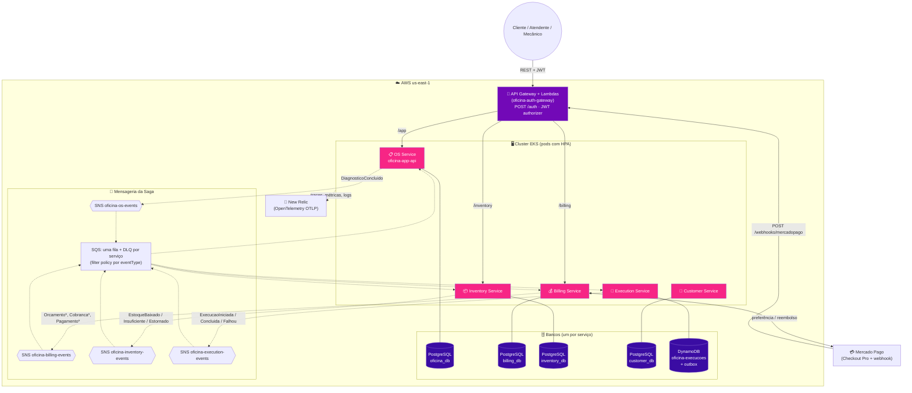
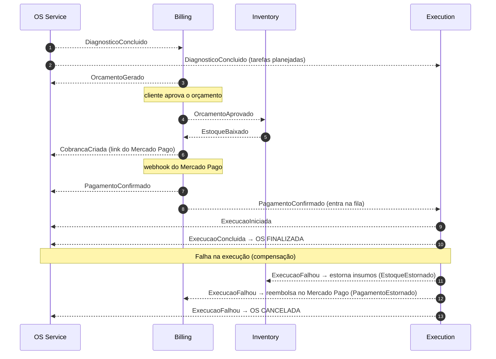
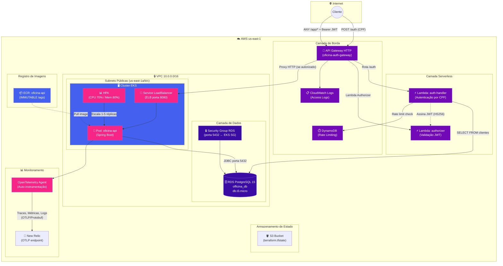
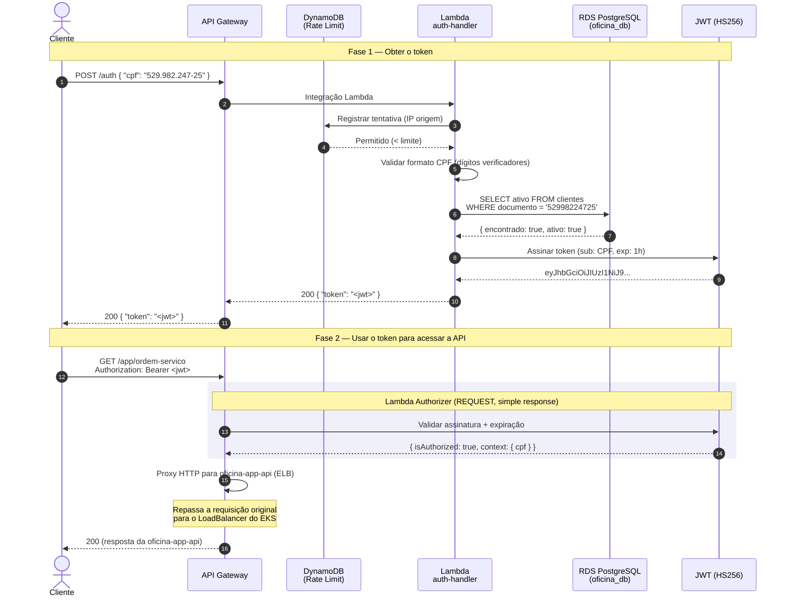
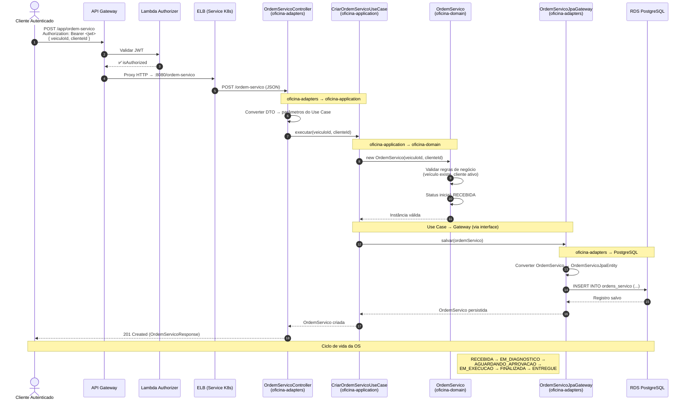
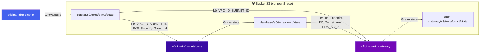
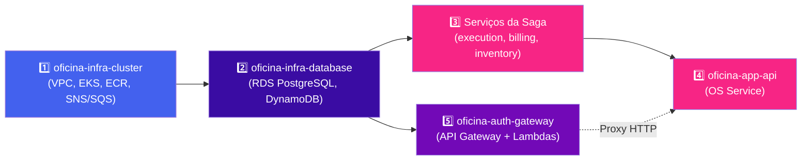

# 🏗️ Arquitetura do Ecossistema Oficina

Visão completa da arquitetura que atravessa todos os repositórios do projeto Oficina (Fase 4:
microsserviços com Saga coreografada). Para a arquitetura interna do serviço de OS (Clean
Architecture, módulos Maven, data flow), consulte [arquitetura.md](arquitetura.md).

---

## Repositórios e responsabilidades

Cada microsserviço tem repositório, pipeline, imagem e banco próprios. A infraestrutura
compartilhada fica em repositórios de Terraform.

| Repositório | Responsabilidade | Banco | Tecnologia |
|---|---|---|---|
| [`oficina-app-api`](https://github.com/GrupoPosTech-FIAP/oficina-app-api) | **OS Service**: abertura e diagnóstico da OS, status e histórico da Saga, catálogo de serviços, veículos, notificações ao cliente | PostgreSQL (`oficina_db`) | Java 25, Spring Boot 4, Clean Architecture multi-módulo |
| [`oficina-billing-service`](https://github.com/GrupoPosTech-FIAP/oficina-billing-service) | **Billing Service**: orçamento, aprovação, cobrança no Mercado Pago (Checkout Pro), webhook de pagamento, timeouts e reembolso | PostgreSQL (`billing_db`) | Java 25, Spring Boot 4, SDK Mercado Pago |
| [`oficina-inventory-service`](https://github.com/GrupoPosTech-FIAP/oficina-inventory-service) | **Inventory Service**: catálogo de insumos, baixa de estoque por OS (tudo ou nada) e estorno | PostgreSQL (`inventory_db`) | Java 25, Spring Boot 4 |
| [`oficina-execution-service`](https://github.com/GrupoPosTech-FIAP/oficina-execution-service) | **Execution Service**: fila de execução, tarefas por serviço, andamentos (diagnóstico, reparo, teste), conclusão ou falha e tempo médio | **DynamoDB** (NoSQL) | Java 25, Spring Boot 4, AWS SDK v2 |
| [`oficina-customer-service`](https://github.com/GrupoPosTech-FIAP/oficina-customer-service) | **Customer Service**: cadastro de clientes (CPF/CNPJ, soft delete) | PostgreSQL (`customer_db`) | Java 25, Spring Boot 4 |
| [`oficina-auth-gateway`](https://github.com/GrupoPosTech-FIAP/oficina-auth-gateway) | Porta de entrada: autenticação por CPF (Lambda), autorizador JWT e roteamento para os serviços | DynamoDB (rate limit) | Node.js 20, TypeScript, Terraform |
| [`oficina-infra-cluster`](https://github.com/GrupoPosTech-FIAP/oficina-infra-cluster) | VPC, cluster EKS, repositórios ECR e a mensageria da Saga (tópicos SNS, filas SQS e DLQs) | — | Terraform |
| [`oficina-infra-database`](https://github.com/GrupoPosTech-FIAP/oficina-infra-database) | Instância RDS PostgreSQL e as tabelas DynamoDB do execution | — | Terraform |

**Banco por serviço:** os serviços relacionais usam bases lógicas separadas na mesma instância RDS
(cada serviço cria e usa só a sua base), e o execution usa DynamoDB.
Nenhum serviço lê o banco de outro: tudo que um serviço precisa de outro chega por evento.

---

## Diagrama geral da arquitetura (Fase 4)

Microsserviços, bancos e comunicação. As setas cheias são chamadas síncronas (REST); as
tracejadas são eventos da Saga (SNS → SQS).

### Quem consome o quê

Um tópico SNS por serviço produtor e uma fila SQS por serviço consumidor; cada fila assina só os
eventos de que precisa (`messaging.tf` em `oficina-infra-cluster`).

| Fila | Eventos consumidos |
|---|---|
| `oficina-os-queue` | todos os eventos de billing, inventory e execution (o OS Service é dono do status e do histórico) |
| `oficina-billing-queue` | `DiagnosticoConcluido`, `EstoqueBaixado`, `ExecucaoFalhou` |
| `oficina-inventory-queue` | `OrcamentoAprovado`, `PagamentoRecusado`, `PagamentoExpirado`, `ExecucaoFalhou` |
| `oficina-execution-queue` | `DiagnosticoConcluido`, `PagamentoConfirmado` |

---

## Saga Pattern: coreografia

A Saga da OS é **coreografada**: não existe orquestrador. Cada serviço reage a eventos e publica
o resultado do seu passo; as falhas disparam compensações nos serviços que já agiram. Decisão e
alternativas na [ADR 005](adr/005-saga-coreografada.md); máquina de estados e compensações em
[saga.md](saga.md).

**Por que coreografia:** são quatro serviços com passos bem definidos e cada um já é dono da sua
regra (o billing decide sobre pagamento, o inventory sobre estoque). Um orquestrador central
concentraria regras de todos e viraria ponto único de falha e de deploy. A coreografia mantém os
serviços independentes; o custo, que é perder a visão central do fluxo, é coberto pelo histórico
da Saga no OS Service e pelos logs com `saga_id` no New Relic.

**Garantias de consistência em todos os serviços:**
- **Transactional outbox:** o evento é gravado na mesma transação da mudança de estado (no
  DynamoDB, com `TransactWriteItems`) e um relay publica no SNS.
- **Consumidor idempotente:** eventos repetidos ou fora de ordem são descartados sem erro.
- **Compensações idempotentes:** o estorno de estoque e o reembolso só acontecem uma vez por OS.
- **DLQ** em cada fila, com alarme no CloudWatch.

---

## Justificativa da divisão e das tecnologias

**Divisão pelos limites do negócio.** Os serviços seguem as áreas da oficina citadas no desafio:
atendimento e acompanhamento da OS (OS Service), orçamento e pagamento (Billing), peças e
insumos (Inventory), produção na oficina (Execution) e cadastro de clientes (Customer). Cada um
muda por motivos diferentes: o billing por regras de cobrança e do Mercado Pago, o inventory por
regras de estoque, o execution pelo processo da oficina.

| Tecnologia | Por quê |
|---|---|
| Java 25 + Spring Boot 4 | Mesma base nos serviços, que já era a da Fase 3; Clean Architecture em todos |
| PostgreSQL (RDS) | OS, cobrança, estoque e cadastro precisam de transação ACID e restrições (baixa de estoque tudo ou nada, documento único, pagamento não duplicado) |
| DynamoDB | Exigência de NoSQL. A execução é acessada sempre pela OS e guarda o agregado inteiro (tarefas e andamentos) num item; gerenciado e barato no Learner Lab |
| SNS + SQS | Mensageria gerenciada da AWS: fan-out por tópico, filtro por tipo de evento, DLQ e retentativa sem operar broker |
| Mercado Pago Checkout Pro | Exigência do desafio para pagamentos; webhook confirma o pagamento e a API faz o reembolso na compensação |
| API Gateway + Lambda | Porta única com autenticação por CPF e autorizador JWT, já da Fase 3 |
| EKS + Kustomize + HPA | Cada serviço com Deployment, Service e autoescala; overlays para AWS |
| Terraform | Infraestrutura versionada em repositórios separados (cluster e mensageria, bancos, gateway) |
| GitHub Actions | CI em todo PR (build, testes, cobertura mínima de 80% e SonarCloud) e deploy no EKS por serviço |
| OpenTelemetry + New Relic | Mesma observabilidade da Fase 3, agora em todos os serviços da Saga |

---

## Diagrama de Componentes (Fase 3)

O diagrama abaixo é o da Fase 3, com a aplicação monolítica, e mostra em detalhe a camada de
borda (autenticação) e o cluster. As cores indicam qual repositório é responsável por cada
componente.

**Legenda de cores:**
- 🟣 Roxo escuro (`oficina-auth-gateway`) — API Gateway, Lambdas, Rate Limiting
- 🔵 Azul (`oficina-infra-cluster`) — VPC, EKS, ECR
- 🟣 Roxo (`oficina-infra-database`) — RDS, Security Group do banco
- 🩷 Rosa (`oficina-app-api`) — Pod da aplicação, HPA, Service, Monitoramento

---

## Diagrama de Sequência — Autenticação por CPF

O fluxo de autenticação por CPF é implementado inteiramente no `oficina-auth-gateway`,
sem alterações na `oficina-app-api`. O cliente primeiro obtém um JWT e depois o usa para
acessar a API.

**Cenários de erro:**

| Situação | Código | Onde o fluxo para |
|---|---|---|
| IP excedeu limite de tentativas | `429` | Lambda `auth-handler` (step 3) |
| CPF mal formado | `400` | Lambda `auth-handler` (step 4) |
| CPF não cadastrado | `404` | Lambda `auth-handler` (step 5-6) |
| Cliente inativo | `403` | Lambda `auth-handler` (step 6) |
| Token ausente/inválido/expirado | `401` | Lambda Authorizer (step 14) |

---

## Diagrama de Sequência — Abertura de Ordem de Serviço

Este fluxo mostra o caminho de uma requisição desde o cliente autenticado até a persistência
no banco, passando por todas as camadas da Clean Architecture.

---

## Dependências entre repositórios (Terraform Remote State)

Os repositórios de infraestrutura formam uma cadeia de dependências via `terraform_remote_state`.
Os outputs de um repositório são consumidos como data sources pelo próximo.

---

## Ordem obrigatória de deploy

A infraestrutura **deve** ser provisionada nesta ordem. Cada etapa depende dos outputs da anterior.

| Passo | Repo | Como | Depende de |
|---|---|---|---|
| 1 | `oficina-infra-cluster` | `terraform apply` (~10-15 min) | Bucket S3 do state |
| 2 | `oficina-infra-database` | `terraform apply` (~10-15 min) | Passo 1 |
| 3 | `oficina-execution-service`, `oficina-billing-service`, `oficina-inventory-service` | workflow `deploy.yml` de cada repositório (build, imagem no ECR e `kubectl apply`) | Passos 1 e 2 |
| 4 | `oficina-app-api` | workflow `deploy.yml` | Passo 3: a OS depende dos eventos do execution |
| 5 | `oficina-auth-gateway` | GitHub Actions (CD), com as URLs dos LoadBalancers dos serviços | Passos 1 a 4 |

> ⚠️ A destruição deve ser feita na **ordem inversa**.

---

## Contexto: AWS Academy Learner Lab

Toda a infraestrutura roda em um sandbox da AWS com as seguintes restrições:

- **Orçamento virtual** de ~$100 (sem cartão de crédito)
- **Credenciais expiram a cada ~4h** — exigem atualização manual nos GitHub Secrets
- **Região fixa:** `us-east-1` (Norte da Virgínia)
- **Não é possível criar IAM Roles** — todos os repos usam a role pré-existente `LabRole`
- **Alguns serviços avançados são bloqueados** (ex: AWS WAF)

Guia completo de acesso em [`oficina-infra-cluster/docs/acesso-aws-learner-lab.md`](https://github.com/GrupoPosTech-FIAP/oficina-infra-cluster/blob/main/docs/acesso-aws-learner-lab.md).
