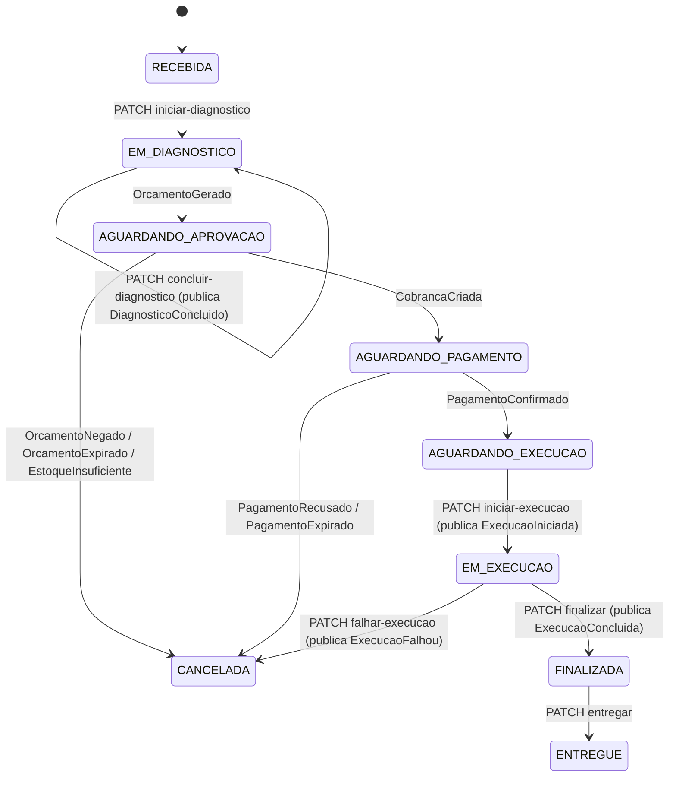

# 🔁 Saga da Ordem de Serviço

Implementação da Saga coreografada da [ADR 005](adr/005-saga-coreografada.md) do ponto de
vista do serviço de OS, que é o dono do status e do histórico. A infraestrutura de eventos
(outbox, SNS/SQS, idempotência) está em [mensageria.md](mensageria.md).

## Decisões desta implementação

- **Orçamento negado cancela a OS** (`CANCELADA`), em vez de voltar para diagnóstico.
- **A execução continua neste serviço.** Enquanto o `oficina-execution-service` não existe,
  iniciar, finalizar e registrar falha são endpoints REST daqui, e `ExecucaoIniciada`,
  `ExecucaoConcluida` e `ExecucaoFalhou` saem do tópico `oficina-os-events`. As assinaturas do
  tópico `execution` ficam prontas no Terraform para quando o serviço for criado.
- **Preço dos itens no diagnóstico.** Serviços são precificados pelo catálogo da OS; o preço
  dos insumos vem no corpo do `concluir-diagnostico` (o catálogo de insumos é do inventory).
- **Não há mais atalho para execução:** `iniciar-execucao` exige `AGUARDANDO_EXECUCAO`, ou seja,
  pagamento confirmado.

## Máquina de estados



`OrcamentoAprovado`, `EstoqueBaixado`, `EstoqueEstornado` e `PagamentoEstornado` não mudam o
status, só entram no histórico. Um evento que não corresponde a uma transição válida a partir
do status atual (fora de ordem ou repetido) é registrado com `descartado = true` e a mensagem
é confirmada, sem erro.

## Quem faz o quê

| Passo | Serviço | Gatilho → evento publicado |
|---|---|---|
| Diagnóstico | os | `PATCH /ordem-servico/{id}/concluir-diagnostico` → `DiagnosticoConcluido` |
| Orçamento | billing | `DiagnosticoConcluido` → gera e envia → `OrcamentoGerado` |
| Aprovação | billing | `PATCH /orcamentos/{id}/aprovar` → `OrcamentoAprovado` (ou `negar` → `OrcamentoNegado`) |
| Baixa de estoque | inventory | `OrcamentoAprovado` → `EstoqueBaixado` ou `EstoqueInsuficiente` (tudo ou nada) |
| Cobrança | billing | `EstoqueBaixado` → preferência no Checkout Pro → `CobrancaCriada` (com `checkoutUrl`) |
| Pagamento | billing | webhook do Mercado Pago → `PagamentoConfirmado` ou `PagamentoRecusado` |
| Execução | os | `iniciar-execucao` → `ExecucaoIniciada`; `finalizar` → `ExecucaoConcluida` |
| Timeouts | billing | agendador → `OrcamentoExpirado`, `PagamentoExpirado` |

## Compensações

| Falha | O que já aconteceu | Compensação | OS |
|---|---|---|---|
| Orçamento negado ou expirado | Orçamento criado | — | `CANCELADA` |
| `EstoqueInsuficiente` | Orçamento aprovado | — (a baixa confere tudo antes de alterar) | `CANCELADA` |
| Pagamento recusado ou expirado | Estoque baixado | inventory devolve os insumos → `EstoqueEstornado` | `CANCELADA` |
| `ExecucaoFalhou` | Estoque baixado e pagamento confirmado | inventory devolve os insumos → `EstoqueEstornado`; billing reembolsa no Mercado Pago → `PagamentoEstornado` | `CANCELADA` |

As compensações são idempotentes: o inventory guarda o que baixou por OS e só estorna uma
vez; o billing só estorna cobrança `PAGO`, e o reembolso usa uma chave de idempotência fixa
por pagamento.

## Histórico

`GET /ordem-servico/{id}/historico` devolve, em ordem, cada evento publicado ou recebido:

```json
[
  {"evento": "DiagnosticoConcluido", "origem": "PUBLICADO", "statusAnterior": "EM_DIAGNOSTICO", "statusAtual": "EM_DIAGNOSTICO", "descartado": false},
  {"evento": "OrcamentoGerado", "origem": "RECEBIDO", "statusAnterior": "EM_DIAGNOSTICO", "statusAtual": "AGUARDANDO_APROVACAO", "descartado": false, "detalhe": "{\"valorTotal\":215.0,...}"},
  {"evento": "EstoqueInsuficiente", "origem": "RECEBIDO", "statusAnterior": "AGUARDANDO_APROVACAO", "statusAtual": "CANCELADA", "descartado": false}
]
```

`detalhe` guarda o payload recebido (por exemplo o `checkoutUrl` da cobrança) ou o motivo da
falha na execução.

## Testes

- `ProcessarEventoSagaUseCaseTest`: todas as transições da tabela, evento fora de ordem, OS inexistente.
- `SagaOrdemServicoIntegrationTest` (Postgres via Testcontainers): diagnóstico publica os itens
  precificados; caminho até a execução com falha e compensações; estoque insuficiente; evento
  fora de ordem; execução bloqueada sem pagamento.
- Os passos de billing e inventory têm testes de integração próprios em cada repositório
  (`SagaBillingIntegracaoTest`, `SagaEstoqueIntegracaoTest`).
